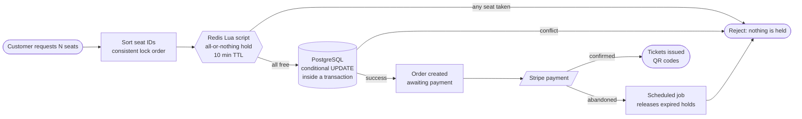
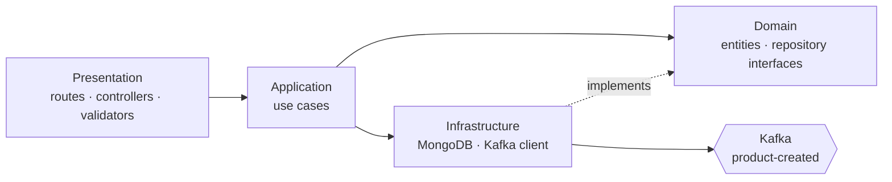
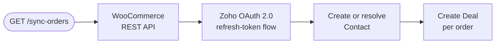

<div align="center">


<br/>

<a href="https://www.linkedin.com/in/yousef-rashed-80286b2a3"></a>
<a href="mailto:yosef22363033@gmail.com"></a>
<a href="https://github.com/roshdyosf?tab=repositories"></a>


<br/><br/>


</div>

```php
<?php

final class YousefRashed implements SoftwareEngineer
{
    public string $role = 'Software Engineer';

    /** @var string[] */
    public array $stack = ['Laravel', 'Node.js', 'Go', 'PostgreSQL', 'Redis', 'Kafka'];

    public function builds(): string
    {
        return 'APIs that never double-book';
    }

    /** @return string[] */
    public function principles(): array
    {
        return ['atomic over optimistic', 'spec before code', 'tests that try to break it'];
    }
}
```

## ⚡ Who I Am

<table>
<tr>
<td width="58%" valign="top">

I'm a **backend engineer** who is drawn to the parts of server-side work where things can go wrong: **race conditions, inconsistent data, weak auth, leaky architecture**.

I build RESTful APIs with **Laravel** and **Node.js**, I've built services in **Go**, and I like proving my systems hold up: atomic Redis operations, idempotent payments, rate limits per scope, and tests that deliberately try to break the happy path.

When I design a system I start with the spec, the data model, and the failure cases, and only then write code.

</td>
<td width="42%" valign="top">

| | |
|---|---|
| 🎯 **Focus** | Backend, APIs, system design |
| 🔐 **Security** | OAuth 2.0 · JWT · 2FA · WebAuthn |
| ⚡ **Concurrency** | Redis Lua · row-level locks |
| 🧱 **Architecture** | DDD · Clean Architecture |
| 💳 **Integrations** | Stripe · Zoho CRM · WooCommerce |
| 📨 **Messaging** | Apache Kafka |
| 🎓 **Education** | B.Tech, CS specialization (2025) |

</td>
</tr>
</table>


## 🧰 Tech Stack

<div align="center">

<table>
<tr>
<td align="center" width="170"><b>Languages</b></td>
<td></td>
</tr>
<tr>
<td align="center"><b>Backend</b></td>
<td></td>
</tr>
<tr>
<td align="center"><b>Data and Messaging</b></td>
<td></td>
</tr>
<tr>
<td align="center"><b>Frontend Exposure</b></td>
<td></td>
</tr>
<tr>
<td align="center"><b>DevOps and Tooling</b></td>
<td></td>
</tr>
</table>

</div>

<details>
<summary><b>📚 Expand the full skill map</b></summary>
<br>

| Area | What I work with |
| --- | --- |
| **Backend** | Laravel 12/13, Node.js, Express.js, Go (Chi), REST API design, MVC, Clean Architecture, DDD, event-driven architecture, background workers with retry handling |
| **Data** | PostgreSQL, MySQL, MongoDB (Mongoose), Redis, Eloquent ORM, data modeling, transactions, row-level locking, query optimization |
| **Concurrency** | Redis Lua scripts (atomic operations), distributed locking, ordered locking to avoid deadlocks |
| **Security** | JWT, OAuth 2.0 (Google, Zoho CRM), Sanctum, 2FA, Passkeys (WebAuthn), RBAC, authorization policies, API rate limiting |
| **Integrations and docs** | Stripe, Zoho CRM API, WooCommerce REST API, Cloudinary, OpenAPI (Scramble), Postman |
| **Quality** | Pest, PHPUnit, feature and unit tests, PHPStan (Larastan), Laravel Pint, GitHub Actions CI |
| **DevOps** | Git, GitHub, Docker, Docker Compose, Render |
| **Concepts** | OOP, SOLID, system design |

</details>


## 🏆 Flagship Project

<div align="center">

### 🎟️ High-Concurrency Ticketing API

**An event-ticketing REST API engineered so two people can never book the same seat.**

<a href="https://github.com/roshdyosf/high-concurrency-ticketing-api"></a>

       

</div>

### How a seat hold works



### What's inside

| | |
|---|---|
| ⚛️ **Atomic multi-seat holds** | A Redis Lua script (all-or-nothing, 10-minute TTL) combined with a conditional PostgreSQL update inside a transaction. Sorted lock ordering avoids deadlocks. |
| 🪑 **Hybrid seating** | Specific seats or general admission, plus adjacent-seat auto-suggestion. |
| 📐 **Spec-first design** | A technical specification covering **12 tables, 45+ endpoints**, role permissions, and order and refund state machines. |
| 🔐 **Auth and access** | Sanctum tokens, email verification, password reset, role middleware (customer, organizer, admin), ownership policies, and a global ban middleware that revokes active tokens. |
| 🚦 **Rate limiting** | Redis-backed, per scope: login (per IP and per email), booking, scanning, and public endpoints. |
| 💳 **Stripe lifecycle** *(in active development)* | Idempotency keys, signed webhooks with duplicate-event protection, automatic refunds for late payments, and a job that releases expired holds. |
| 🎫 **Event features** | Event-scoped gatekeepers, organizer-managed refunds, discount codes, and dynamic QR-code tickets. |
| ✅ **Quality** | **130+ Pest tests** including concurrency scenarios, Larastan level 6, Laravel Pint, Docker Compose (app, PostgreSQL, Redis, scheduler), and OpenAPI docs via Scramble. |


## 🚀 More Projects

### 💰 Family Eco: Household Finance Tracker

<a href="https://github.com/roshdyosf/fEco"></a>
<a href="https://feco.onrender.com/"></a>

      

A shared finance app where families jointly track income, expenses, and balance, with every family isolated behind an invite-code join system.

- **Atomic balance updates**: database transactions with row-level locking keep the balance correct under concurrent writes.
- **Full auth suite**: email verification, password reset, **Google OAuth 2.0**, **two-factor auth with recovery codes**, and **passkey (WebAuthn) login**.
- **RBAC** with Spatie Laravel Permission (family-head and family-member roles, seven permissions), a service-layer architecture, and Form Request validation.
- **CI pipeline**: Pest, PHPStan, Laravel Pint, and GitHub Actions.

<div align="center">
  
  
  
</div>

<br/>

### 📦 Product Catalog API (Domain-Driven Design)

<a href="https://github.com/roshdyosf/Product-Catalog-DDD"></a>
<a href="https://product-catalog-ddd.onrender.com/api/v1/products"></a>

    

A microservice split into strict DDD layers that publishes a domain event to Kafka whenever a product is created.



- Repository interfaces and use cases keep the domain free of framework code.
- Filtering, sorting, pagination, field selection, validation, centralized error handling, and rate limiting (100 requests per hour per IP).
- Separate dev and prod Docker Compose files, deployed on Render, with a Postman collection.

<br/>

### 🎓 Content Management API (MAHD E-Learning Backend)

<a href="https://github.com/roshdyosf/content-mangement-apis"></a>

  

The backend behind the MAHD content and e-learning platform, built with **Clean Architecture** so business logic stays independent from framework dependencies.

- APIs for **content and course management** and **student tracking**.
- Global error-handling middleware for consistent API responses.

<br/>

### 🌍 NTS: Tour Management and Booking Platform

<a href="https://github.com/roshdyosf/ntsPJ"></a>

     

A server-rendered booking platform and API for tours, bookings, users, and reviews.

- MVC backend with filtering, sorting, pagination, and field limiting.
- **Stripe** payments and booking management, **JWT** authentication, and role-based authorization.
- Mongoose-backed review and rating system, seeding scripts, and API docs (OpenAPI and a static web doc).

<br/>

### 🔄 Zoho WooCommerce Sync

<a href="https://github.com/roshdyosf/zoho-woo-sync"></a>

   

An integration that turns WooCommerce orders into Zoho CRM contacts and deals.




## 📊 GitHub Activity

<div align="center">


</div>


## 🎓 Education and Learning

| | |
|---|---|
| 🎓 **B.Tech, Industrial and Energy Technology** | Computer Science specialization · Faculty of Industrial Technology and Energy · July 2025 |
| 🐍 **Full Stack Web Development using Python** | 120 hrs · Information Technology Institute (ITI) · 2024 · OOP, PostgreSQL, Flask, Django |
| 🟢 **Node.js, Express, MongoDB and More** | 42 hrs · Udemy · 2026 |
| 🤖 **AI and Python Fundamentals** | ITIDA |

## 🤝 Let's Build Something

I'm open to **backend engineering** opportunities: APIs, concurrency-sensitive systems, and clean architecture.

<div align="center">

<a href="https://www.linkedin.com/in/yousef-rashed-80286b2a3"></a>
<a href="mailto:yosef22363033@gmail.com"></a>


</div>
